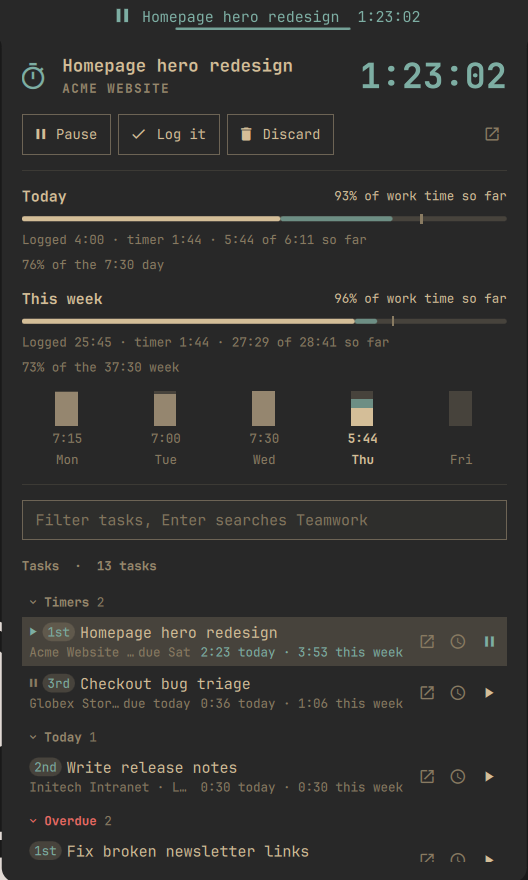

# Teamwork timers for Omarchy

A bar widget for [Teamwork.com](https://www.teamwork.com) time tracking in the [Omarchy](https://omarchy.org) shell. The running timer and its task tick in the bar; the panel lets you start, pause, log and discard timers, log time by hand, and see how much of your work time today and this week is accounted for. It nudges you when nothing is timing during work hours.



## Install

```bash
omarchy plugin add https://github.com/tomhayes/omarchy-teamwork --enable
```

Requires `python3` (standard library only), `notify-send`, `xdg-open`, and optionally `secret-tool` (libsecret) for keyring storage.

## First run

1. Click the timer icon in the bar. The panel opens on **Settings**.
2. Enter your site address, `https://<yours>.teamwork.com` (https only, no path), and press **Save settings**.
3. Paste your API key and press **Save key**. Find it in Teamwork under your profile, *Edit my details*, *API & Mobile*. The key is checked against Teamwork before it's stored.

The key goes to `bin/teamwork set-key` on stdin and is stored in the Secret Service keyring (`secret-tool`, attributes `service tomhayes.teamwork account api-key`). Without a keyring it falls back to `~/.local/state/tomhayes.teamwork/api-key` (mode 0600, directory 0700), and Settings says so. **Remove** deletes it.

## Using it

- **Bar**: the glyph pauses or resumes the current timer (with none, it restarts the last task); the text or a right click opens the panel; a middle click refreshes. While nothing is timing during work hours the pill is tinted toward the urgent colour.
- **Current timer**: pause/resume, **Log it** (completes the timer as a time entry, with an optional description), **Discard** (asks first), open in Teamwork.
- **Today / This week**: time logged plus unlogged timer time, against the work time elapsed so far and the full day or week, with a bar per work day.
- **Tasks**: your open assigned tasks plus anything with a timer or time logged this week, grouped by due date (Timers, Today, Overdue, Tomorrow, This week, Next week, Later, No due date). Filter locally; press Enter with no local match to search Teamwork. Each row can start a timer, log time by hand, or open the task.
- **Sort field** (optional): name a Teamwork task custom field and its value shows as a badge on each task; tasks whose value starts with a number ("1st", "2", "#3") sort first in their group, lowest first.

Keys in the panel: `p` pause/resume, `/` or `f` filter, `s` settings, `r` refresh, Up/Down or `j`/`k` scroll, Esc backs out.

## Settings

Edited in the panel's Settings (the cog) or the stock Omarchy widget settings, and saved to the widget's entry in `~/.config/omarchy/shell.json`. The API key is never written there.

| Key | Default | Meaning |
|---|---|---|
| `siteUrl` | `""` | Your Teamwork address, `https://<yours>.teamwork.com`. Empty means not set up. |
| `sortField` | `""` | Task custom field to show and rank by, matched ignoring case. Empty turns it off. |
| `workDays` | `1,2,3,4,5` | ISO weekdays, 1 = Monday. |
| `workStart` / `workEnd` | `09:00` / `17:30` | Work hours, 24-hour `HH:MM`. |
| `lunchStart` / `lunchEnd` | `12:30` / `13:30` | Lunch, not counted as work time. |
| `nagEnabled` | `true` | Notify when no timer is running during work hours. |
| `nagIntervalMin` | `15` | Minutes between nags (5–120). |
| `refreshIntervalSec` | `60` | Background refresh interval in seconds (15–3600); `0` turns background polling off. |
| `longTimerWarnHours` | `3` | Warn once when a timer passes this many hours; 0 is off. |
| `notifyAfterHours` | `true` | Warn once a day each if a timer is still running at lunch or after hours. |

## Network use

All traffic goes through `bin/teamwork`, over HTTPS, to the site URL you set, and only once a key is saved. Redirects are not followed. It calls the Teamwork Projects v3 API:

| When | Endpoints |
|---|---|
| Each refresh | `GET /projects/api/v3/me/timers.json`, `tasks.json` (your open tasks, plus tasks you timed this week), `time.json` (this week's time entries); `me.json` once, then cached |
| Starting, pausing, resuming, logging, discarding | `POST me/timers.json`, `PUT me/timers/{id}[/pause\|/resume\|/complete].json`, `DELETE me/timers/{id}.json`, `GET tasks/{id}.json`, `GET timers/{id}.json`, `POST tasks/{id}/time.json` |
| Searching | `GET tasks.json?searchTerm=…` |
| Saving the key | `GET me.json`, to check it |

It refreshes in the background every `refreshIntervalSec` (60 s by default, configurable from 15 s to an hour), when the panel opens, and after each action; after failures it backs off, doubling up to 10 minutes. With several monitors only one bar instance polls. Set `refreshIntervalSec` to `0` to turn background polling off: it then contacts Teamwork only when the shell starts, when the panel opens, and after an action you take. The running timer still ticks locally, but reminders and warnings rely on the last refresh, so a timer started or stopped elsewhere (the Teamwork web app, another machine) isn't noticed until the next one.

Each request times out after 15 s of silence and each helper call after 90 s in all; responses over 5 MiB are refused. The custom-field sideload (`include=customfieldTasks,customfields`) is requested only when `sortField` is set. Nothing else is contacted: no telemetry, no update checks. Opening a task hands its URL to `xdg-open`.

## Notifications

Sent with `notify-send`, all optional in Settings:

- **No timer running**: during work hours (outside lunch), after `nagIntervalMin` minutes with nothing timing, with **Resume/Start** and **Open** actions. Each nag replaces the last.
- **Timer still running**: once per timer, past `longTimerWarnHours`.
- **Lunch / after hours**: once a day each, if a timer is still running.

With background polling off (`refreshIntervalSec` 0), these rely on the last refresh: open the panel now and then to keep them accurate.

## IPC

```bash
omarchy-shell tomhayes.teamwork open|close|toggle|show|hide
omarchy-shell tomhayes.teamwork settings      # open on Settings
omarchy-shell tomhayes.teamwork toggleTimer   # same as clicking the glyph
omarchy-shell tomhayes.teamwork refresh
omarchy-shell tomhayes.teamwork state         # JSON summary, no secrets
```

## Privacy and security

- The API key is read from the keyring or the 0600 file only by `bin/teamwork`; it is never printed, logged, cached, put in `shell.json`, or passed on a command line.
- `~/.cache/tomhayes.teamwork/me.json` caches your Teamwork user id and name, nothing else.
- Text from Teamwork is shown as plain text and bounded (names to 300 characters, sort-field values to 40, at most 500 tasks). In notification text, markup characters are replaced with look-alikes, URLs are kept from turning into links, and bidirectional-override characters are dropped.
- Commands run as argv arrays, never through a shell. Task links are built from the validated site URL and a numeric id.
- The site URL must be a bare `https://` origin: no credentials, port, path or query. Custom Teamwork domains work, so the key goes to whatever site you enter: check it before saving the key.

## Tests

```bash
python3 -m unittest discover -s tests   # helper, against a local mock Teamwork server
node --test ui-tests/                   # work-time maths, snapshot model, due groups
```

The helper tests never touch your keyring or real state: they point `HOME`, the XDG directories and `secret-tool` at temporary fakes.

## License

[MIT](LICENSE)
